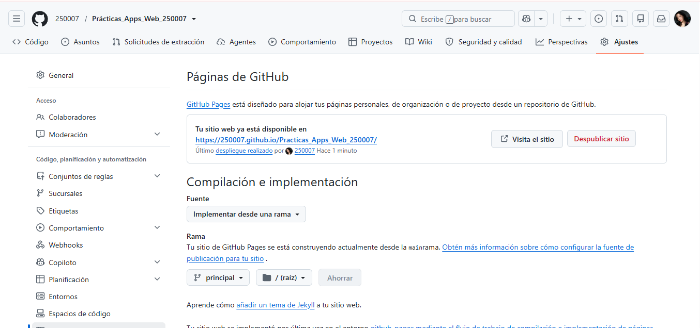

# Prácticas de la Asignatura de Aplicaciones Web

**T.S.U. en Desarrollo de Software Multiplataforma**

- **Estudiante:** Jimena García Ramírez (Matrícula: 250007)
- **Docente:** M.T.I. Marco Antonio Ramírez Hernández
- **Periodo:** Septiembre - Diciembre

---

## Tabla de Prácticas de la Materia

| No. | Nombre de la Práctica | Descripción | Potenciador | Estatus |
| :-: | :--- | :--- | :-: | :-: |
| **1** | Metodología de la Evaluación | Transcribir en libreta y comprender la metodología y fechas de la evaluación de la asignatura. | 5 | 🟢 Concluida |
| **2** | Mi Primera Página Web | Codificar la primera página web estática estructurada con HTML5 puro, sin estilos ni funcionalidades avanzadas. | 10 | 🟢 Concluida |
| **3** | Práctica 03: Mi Portafolio Web | Desarrollo e implementación de un portafolio web personal e interactivo utilizando HTML5 semántico, maquetación moderna con CSS3 (Flexbox/Grid) y manipulación del DOM con JavaScript. | 10 | 🟢 Concluida |

---

## 🌐 Reto Opcional: Publicación y Hospedaje en GitHub Pages

**Modalidad:** Reto individual, autodidacta y opcional.  
**Evidencia:** Documentación del procedimiento, retos técnicos y soluciones aplicadas para el despliegue del portafolio web.

### 🔗 Enlaces de Acceso
- **URL Pública del Portafolio:** [https://250007.github.io/Practicas_Apps_Web_250007/](https://250007.github.io/Practicas_Apps_Web_250007/)
- **Repositorio de GitHub:** [https://github.com/250007/Practicas_Apps_Web_250007](https://github.com/250007/Practicas_Apps_Web_250007)

---

### 1. Procedimiento Realizado
1. **Configuración de GitHub Pages:** En los ajustes del repositorio (`Settings > Pages`), se configuró el despliegue desde la rama principal `master` apuntando al directorio raíz (`/root`).
2. **Creación de archivo de redirección:** Se maquetó e integró un archivo `index.html` en la raíz del repositorio con la metaetiqueta `<meta http-equiv="refresh" content="0; url=practica03/index.html">`. Esto permite que al ingresar al dominio principal se redirija de manera transparente e inmediata al portafolio ubicado en la subcarpeta `practPara cumplir con la solicitud estricta del **Reto Opcional** y entregar una **documentación breve, concisa y directa** dentro del archivo `README.md` (sin sobrecargar el documento), puedes sustituir o integrar este bloque redactado específicamente para tu evaluación:

```markdown
---

## 🌐 Reto Opcional: Hospedaje y Publicación en GitHub Pages

**URL Pública:** [https://250007.github.io/Practicas_Apps_Web_250007/](https://250007.github.io/Practicas_Apps_Web_250007/)  
**Repositorio:** [https://github.com/250007/Practicas_Apps_Web_250007](https://github.com/250007/Practicas_Apps_Web_250007)

### 1. Procedimiento Realizado
1. **Redirección de entrada:** Se creó un archivo `index.html` en la raíz del repositorio con la etiqueta `<meta http-equiv="refresh">` que direcciona automáticamente a `practica03/index.html`.
2. **Publicación en el servidor:** En la sección *Settings > Pages* de GitHub, se configuró la rama `master` y el directorio `/ (root)` como fuente de compilación.
3. **Verificación de despliegue:** Se validó la respuesta del flujo en *GitHub Actions* hasta obtener el estado activo (*live*) y se comprobaron los recursos multimedia en línea.

### 2. Dificultades Encontradas
- **Navegación por subcarpetas:** Al acceder a la raíz del dominio público de GitHub Pages, no se abría directamente el portafolio debido a que reside en la carpeta `practica03/`.
- **Fallos en el build de Actions:** Se presentaron errores de compilación causados por conflictos de merge en el archivo `README.md` y rastreos obsoletos de submódulos en Git local.

### 3. Soluciones Implementadas
- **Automatización de ruta:** Se integró la redirección HTML en la raíz sin modificar la estructura original de carpetas del proyecto.
- **Sincronización y limpieza:** Se resolvieron los conflictos de historial mediante `git pull` / `git merge` y se depuraron las referencias anidadas de Git en la terminal de VS Code antes del `push` final.

---

### 📷 Evidencias del Despliegue

| Configuración en GitHub Pages | Portafolio Web Funcional |
| :---: | :---: |
|  |  |